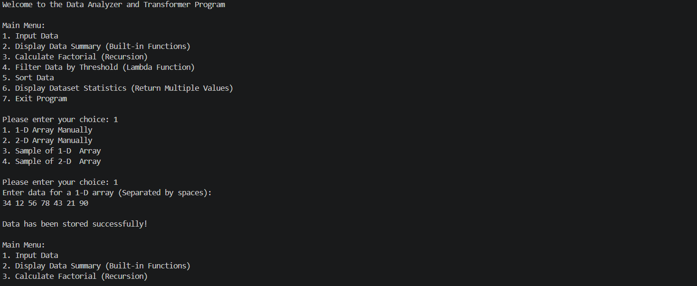
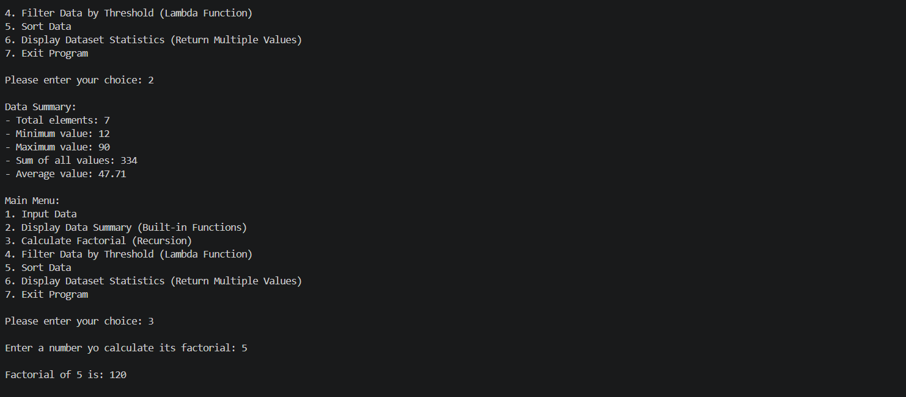
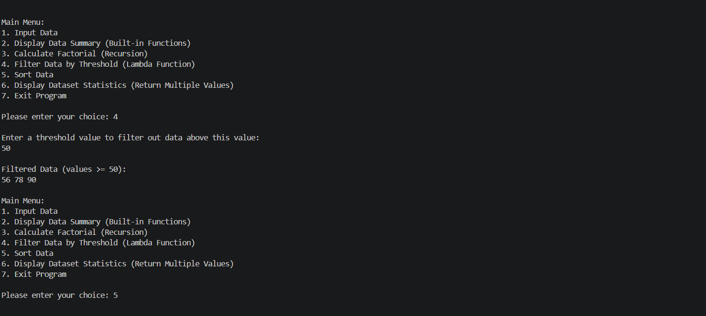
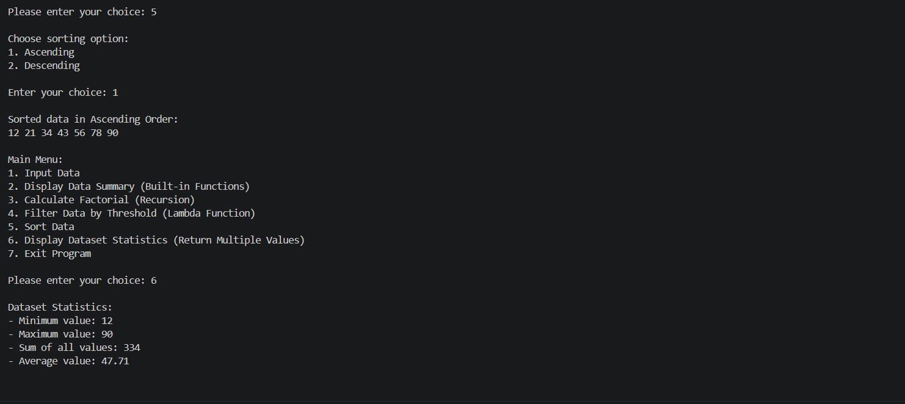
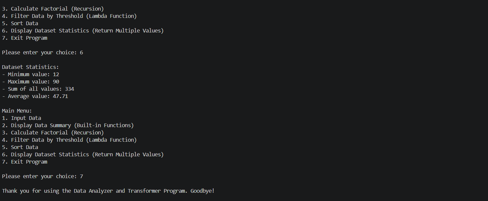

# PR.4 Functional Treat:

## 1. Introduction:
The Data Analyzer and Transformer Program is a menu-driven that allows users to input, analyze, filter, and sort numerical datasets.

The program supports both 1-D and 2-D lists and demonstrates various Python programming concepts such as functions, recursion, lambda functions, built-in functions, and multiple return values.

## 2. Features:

The program provides the following features:

### 1. Input Data:
- Enter a 1-D array manually.
- Enter a 2-D array manually.
- Use a predefined sample of a 1-D array.
- Use a predefined sample of a 2-D array.

### 2. Display Data Summary:
- Calculate the total number of elements.
- Find the minimum value.
- Find the maximum value.
- Calculate the sum of all values.
- Calculate the average up to 2 decimal places.

### 3. Calculate Factorial:
- Calculate the factorial of a number using recursion.

### 4. Filter Data by Threshold:
- Filter values greater than or equal to the given threshold.
- Uses the `filter()` function and a lambda function.

### 5. Sort Data:
- Sort data in ascending order.
- Sort data in descending order.

### 6. Display Dataset Statistics:
- Find the minimum value.
- Find the maximum value.
- Calculate the sum of all values.
- Calculate the average.
- Return multiple values from a function.

### 7. Exit Program:
- Terminates the program.

## 3. Python Concepts Used:

1. **Lists (1-D and 2-D Lists):** Used to store and manage numerical datasets.

2. **Global Variables:** Used to access and modify the dataset throughout the program.

3. **Functions:** Used to divide the program into smaller, reusable blocks of code.

4. **List Methods (`append()` and `extend()`):** Used to add individual elements and multiple elements to a list.

5. **`isinstance()`:** Used to check whether an element is a list or another data type.

6. **List Flattening:** Used to convert a 2-D list into a 1-D list.

7. **Built-in Functions:** Used `sum()`, `min()`, `max()`, `len()`, `sorted()` and `isinstance()` to perform different operations.

8. **Recursion:** Used to calculate the factorial of a number by calling the same function repeatedly.

9. **Lambda Function:** Used to create an anonymous function for checking the threshold condition.

10. **Filter Function:** Used to filter elements that are greater than or equal to the given threshold.

11. **Sorting:** Used to arrange dataset elements in ascending and descending order.

12. **Multiple Return Values:** Used to return minimum, maximum, sum, and average from a single function.

13. **Match-Case Statement:** Used to implement the menu-driven program and handle user choices.

14. **Conditional Statements:** Used to check conditions and handle different situations.

15. **Loops (`for` and `while`):** Used to iterate through datasets and repeatedly display the main menu.

16. **User Input and Type Conversion:** Used `input()` and `int()` to accept and convert user input.

17. **F-Strings:** Used to display formatted output, including the average up to two decimal places.

18. **Docstrings:** Used to describe the purpose of functions.

